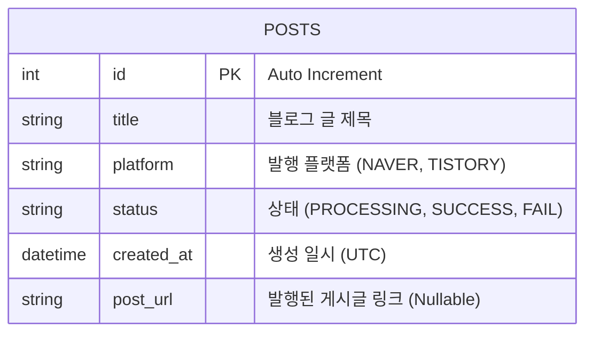

# 🗄️ Post Flow DB 스키마 명세서

> **문서 버전:** 1.0.0
> **작성일:** 2026-02-02
> **관련 파일:** `backend/app/db/models.py`, `backend/app/schemas/post.py`

---

## 1. 개요 (Overview)
본 문서는 **Post Flow** 시스템의 백엔드 데이터베이스 구조를 정의한다. 현재 단계(MVP)에서는 포스팅 이력 관리를 위한 단일 테이블 구조를 가지며, **SQLite**를 사용하여 로컬 파일(`postflow.db`) 형태로 저장된다.

## 2. ERD (Entity Relationship Diagram)



## 3. 테이블 상세 명세 (Table Schema)

### 3.1 `posts` (포스팅 이력)
사용자가 AI를 통해 생성하고 발행을 요청한 포스팅 내역을 저장한다.

| 필드명 (Field) | 데이터 타입 (Type) | 제약 조건 (Constraints) | 설명 (Description) |
| :--- | :--- | :--- | :--- |
| `id` | `Integer` | **PK**, Auto Increment | 고유 식별자 |
| `title` | `String` | Not Null, Index | 최종 확정된 블로그 글 제목 |
| `platform` | `String` | Not Null | 발행 대상 플랫폼 (예: `NAVER`, `TISTORY`) |
| `status` | `String` | Not Null | 발행 상태 코드 |
| `created_at` | `DateTime` | Default: `UTC Now` | 데이터 생성 일시 |
| `post_url` | `String` | Nullable | 실제 발행 완료된 게시글의 URL (발행 성공 시 업데이트) |

#### 상태 코드 (Status Codes)
- **PROCESSING:** 발행 요청이 접수되어 작업 대기 중이거나 진행 중인 상태.
- **SUCCESS:** 블로그 발행이 정상적으로 완료된 상태.
- **FAIL:** 발행 중 오류가 발생하여 중단된 상태.

## 4. 데이터 흐름 (Data Lifecycle)

1.  **생성 (Create):** 클라이언트가 `/api/v1/posts/publish` API를 호출하면 `PROCESSING` 상태로 레코드가 생성된다.
2.  **조회 (Read):** `/api/v1/posts/history` API를 통해 전체 이력을 최신순(`created_at desc`)으로 조회할 수 있다.
3.  **갱신 (Update):** (향후 구현) 백그라운드 작업(Job)이 완료되면 `status`를 `SUCCESS`로 변경하고 `post_url`을 업데이트한다.

## 5. SQLAlchemy 모델 코드 (Reference)

```python
# backend/app/db/models.py

class Post(Base):
    __tablename__ = "posts"

    id = Column(Integer, primary_key=True, index=True)
    title = Column(String, index=True)
    platform = Column(String)
    status = Column(String)
    created_at = Column(DateTime, default=datetime.utcnow)
    post_url = Column(String, nullable=True)
```
