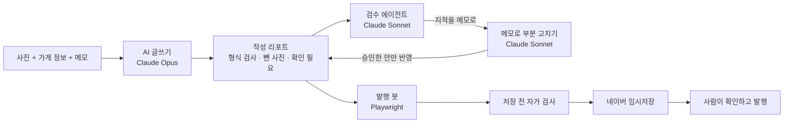
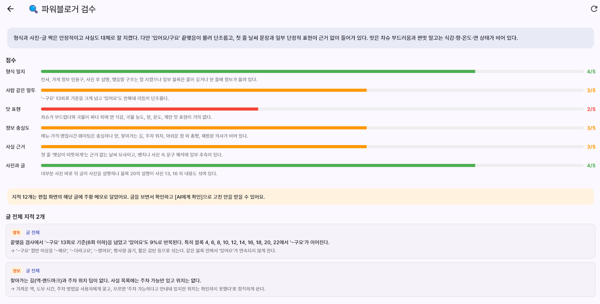

# Post Flow

**사진과 가게 정보를 넣으면 AI가 정해진 형식의 맛집 블로그 글을 쓰고, 봇이 네이버 블로그 편집기에 그대로 입력해 임시저장까지 해 주는 도구**


<!-- 📸 대표 화면 캡처: docs/images/overview.png (편집 화면 + 작성 리포트가 보이게) -->
<!--  -->

## 왜 만들었나

맛집 블로그 글은 매번 형식이 같습니다. 가게 이름 인용구, 지도, 사진 2장 묶음과 짧은 설명, 메뉴별 맛 묘사, 가게 정보, 맺음말 순서입니다. 사진 고르기, 순서 맞추기, 편집기에서 인용구 스타일·글씨 크기·정렬을 하나하나 맞추는 데 시간이 많이 듭니다.

Post Flow는 이 반복 작업을 맡습니다. 사람은 **노트북 앱에서 글을 읽고 확인한 뒤 발행만** 합니다.

- 자동으로 하는 일: 글쓰기, 사진 고르기, 형식 검사, 검수, 메모대로 고친 안 만들기, 편집기 입력, 임시저장
- 사람이 하는 일: 내용 확인, 고칠 곳에 메모 남기기와 안 승인, 사람 얼굴 모자이크, 최종 발행 버튼

## 동작 흐름



1. **가게 정보 가져오기:** 네이버 지도에서 영업시간·주소·리뷰를 가져와 Claude Haiku가 칸별로 정리합니다.
2. **글쓰기:** 사진 전부와 가게 정보, 형식 지시문을 한 번에 넣어 Claude Opus가 블록(글, 사진 묶음, 인용구, 지도) 단위로 씁니다.
3. **작성 리포트:** 형식 검사 결과, 뺀 사진과 그 이유, 사실 확인이 필요한 부분을 앱에 보여 줍니다.
4. **검수:** "파워블로거 시선"의 검수 에이전트가 점수와 지적, 사용자에게 물을 질문을 돌려줍니다. 지적은 해당 글 옆에 메모로 달립니다.
5. **메모로 부분 고치기:** 사용자도 고칠 곳을 드래그해 메모를 남깁니다. AI가 메모마다 "원래 → 고친 글"과 이유를 보여 주고, 사용자가 승인한 안만 그대로 글에 들어갑니다.
6. **발행 봇:** 저장된 로그인으로 편집기를 열어 블록 순서대로 입력하고, 저장 직전 편집기 HTML을 초안과 비교한 뒤 임시저장합니다.
7. **발행 결과 창:** 진행 단계, 자가 검사의 "고칠 것", 실패 이유를 앱에 보여 줍니다.

<!-- 📸 화면 캡처 자리 (넣을 때 주석을 풀어 주세요)
| 홈 (사진·가게 정보) | 편집 화면 · 작성 리포트 | 검수 결과 | 메모로 부분 고치기 | 발행 결과 |
|---|---|---|---|---|
|  |  |  |  |  |
-->

## 주요 기능

### 글쓰기 (`services/post_writer.py`, `prompt_builder.py`)
- 기준 블로그 글의 **형식만** 따르고, 내용은 사진·가게 정보·사용자 메모에 근거해 씁니다. 근거가 없는 만족도·재방문 의사는 쓰지 않고 "확인 필요"로 돌립니다.
- **필요한 사진만 골라 씁니다.** 뺀 사진은 이유와 함께 보여 주고, 앱에서 다시 넣을 수 있습니다.
- 영수증 사진은 카드번호 같은 개인정보가 보여서 **코드로** 글에서 뺍니다(AI 판단에만 맡기지 않음).
- 비슷한 연사 사진은 Pillow만으로 만든 dHash로 묶어 AI에게 힌트로 줍니다(`photo_dedup.py`).
- 사진 번호의 범위·중복·누락은 AI 응답을 받은 뒤 코드로 다시 검증합니다.

### 형식 검사기 (`services/format_checker.py`)
- 기준 블로그의 실제 글 5편에서 잰 값으로 규칙을 만들었습니다. 실제 글 5편은 모두 통과합니다.
- 예: 줄 끝 마침표 비율, 폰에서 꺾이는 줄(20자 초과) 비율, 이모지 위치, 같은 끝맺음 반복, AI가 자주 쓰는 표현("풍미", "조화를 이루" 등), 협찬 글 표시.

### 검수 (`post_reviewer.py`)
- 6개 기준의 점수, 지적(블록 위치와 문제 문장), 사용자에게 물을 질문(예시 답 포함)을 돌려줍니다.
- 검수 에이전트는 글을 직접 고치지 않습니다. 사실이 필요한 보강은 사용자에게 질문으로 돌립니다.
- 지적의 문제 문장은 서버가 실제 글에 있는지 확인한 뒤 앱이 글 안에 표시합니다.

### 메모로 부분 고치기 (`memo_editor.py`, 앱 `memo_logic.dart`)
- 검수 지적은 주황, 사용자 메모는 파랑으로 해당 글 옆에 붙습니다. 글을 드래그하고 우클릭해 메모를 남깁니다.
- [AI에게 확인]을 누르면 체크한 메모 전체를 **한 번의 호출**로 보내고, 메모마다 고친 안과 의견을 받습니다. 앱은 원래 글과 고친 글을 줄 단위로 비교해 보여 줍니다.
- AI가 고칠 수 있는 범위는 **메모 단 글과 바로 앞뒤 글 하나씩**입니다. 범위 밖 수정은 서버가 코드로 버립니다. 사진·지도·인용구는 고치지 않고, 블록 수도 바뀌지 않습니다.
- 안의 "원래 글"은 AI가 아니라 서버가 실제 글에서 채웁니다. 승인할 때는 AI를 다시 부르지 않고, 그 사이 글이 바뀌었으면 승인을 막습니다. 마음에 들지 않으면 답장해서 그 메모만 다시 요청합니다.
- '사실' 지적 메모에는 그 글이 설명하는 사진을 같이 보내, 사진에 보이는 내용이면 고치지 않게 합니다.
- 작업 중인 글(메모·받은 안·검수 결과 포함)은 노트북에 자동 저장되어, 앱을 껐다 켜도 이어서 작업할 수 있습니다.
- 예전 방식인 글 전체 고쳐쓰기(`post_reviser.py`, 한 번만)도 남아 있습니다.

### 발행 봇 (`services/automation/naver_v2.py`)
- 지도 블록, 인용구 스타일, 사진 콜라주, 글씨 크기 15·가운데 정렬, 블록 사이 간격을 기준 블로그 서식에 맞춥니다.
- **저장 전 자가 검사(`editor_check.py`):** 블록 순서, 줄, 빈 줄, 정렬, 글씨 크기, 사진 장수, 지도를 초안과 비교합니다. 문제가 있어도 임시저장은 하고, "고칠 것"으로 알려 줍니다.
- 글에 없는 사진은 올리지 않습니다. `publish(save=False)` 시험 모드는 저장 버튼을 누르지 않습니다.

## 기술 스택

| 구분 | 사용 |
|---|---|
| Backend | Python 3.10, FastAPI, SQLAlchemy(SQLite), Pydantic |
| AI | Claude API (`anthropic` SDK, 구조화된 출력) |
| 자동화 | Playwright(Chrome), playwright-stealth, httpx + BeautifulSoup(크롤링) |
| Frontend | Flutter 3.22 (Windows 앱), Provider |

**용도별 모델** (`core/config.py`, `.env`에서 바꿀 수 있음)

| 용도 | 모델 | 이유 |
|---|---|---|
| 글쓰기 | Claude Opus | 사진 판단과 형식 지키기가 가장 중요해서 |
| 검수·고쳐쓰기·메모 고치기 | Claude Sonnet | 같은 초안으로 비교했을 때 충분했고, 토큰 가격이 Opus의 절반 |
| 가게 정보 정리 | Claude Haiku | 지도 글자를 칸에 옮기는 일이라 Opus와 주요 칸 결과가 같았음 |

## 설계 결정과 문제 해결

### 1. "저장을 눌렀다"는 성공이 아니었다 → 저장 전 자가 검사
봇이 저장까지 마쳤는데도, 정렬과 글씨 크기가 적용되지 않은 글이 있었습니다. 저장 직전 편집기 HTML을 손으로 초안과 비교하고 나서야 알았습니다. 그래서 이 비교를 코드로 만들었습니다(`editor_check.py`). 다시 돌리면 같은 글이 중복으로 임시저장되기 때문에, 문제가 있어도 실패로 처리하지 않고 "고칠 것" 목록으로 돌려줍니다.

### 2. 네이버 보안 확인 → 저장된 로그인 + 고정 Chrome 프로필
매번 아이디·비밀번호로 자동 로그인하면 네이버 보안 확인에 걸려 글쓰기 화면이 로그인 페이지로 돌아갔습니다. 지금은 사람이 한 번 직접 로그인하고, 봇과 로그인 저장이 **같은 Chrome 프로필**을 씁니다. 로그인이 만료되면 다시 시도해도 같은 결과이고 의심 기록만 쌓이므로 **재시도하지 않고** 앱에 로그인 저장 방법을 안내합니다.

### 3. 3장 이상 콜라주의 사진이 사라졌다 → 업로드 완료를 직접 확인
4장 콜라주를 넣으면 2장만 남는 문제가 있었습니다. 단계마다 사진 수를 세어 보니, 업로드 중인 사진은 `data:` 미리보기였다가 서버에 올라가면 `http` 주소로 바뀌었습니다. 그런데 편집기는 **화면에 보이지 않는 칸의 업로드를 마무리하지 않았습니다.** 콜라주 윗줄이 화면 위로 밀리면 그 사진이 미리보기에서 멈췄습니다. 지금은 업로드하는 동안 그 칸을 화면에 보이게 두고, `http` 주소로 바뀐 사진만 셉니다. 자가 검사도 미리보기만 있는 사진을 잡습니다. 같은 조사에서, 콜라주 선택이 버튼이 아니라 "화면 가운데 클릭"이 우연히 맞아서 되던 것도 찾아 고쳤습니다.

### 4. 실패를 숨기던 AI 호출 → Claude API로 옮기고 실패를 드러내기
예전 Gemini 코드는 크레딧이 떨어져 호출이 실패해도 `except: return {}`로 빈 결과와 "성공"을 돌려줬습니다. Claude API로 옮기면서 실패는 한국어 오류 메시지로 앱에 알리고, 실패한 호출도 청구되므로 사용량을 먼저 기록하도록 했습니다.

### 5. 글쓰기 비용이 약 1.5배가 됐다 → 원인부터 측정
같은 사진으로 쓴 글의 비용이 $0.24에서 $0.35로 늘었습니다. 무료 토큰 세기 API로 보이는 응답의 토큰을 세어 보니, 늘어난 출력의 대부분은 AI가 속으로 생각하는 데 쓴 토큰이었습니다(약 3,700 → 7,800, 추정). 생각을 줄이는 설정(effort low)은 절약액(편당 약 $0.08)에 비해 품질 위험이 커서 적용하지 않았습니다. 대신 생각 토큰을 응답 사용량에 따로 기록해 앞으로 바로 볼 수 있게 했습니다.

### 6. 화면에는 보이는데 저장하면 사라지는 글 → 한 글자씩 타이핑
초기에는 Playwright의 `insert_text`로 글을 한 번에 넣었는데, 화면에는 글이 보여도 저장하면 내용이 비어 있었습니다. 네이버 편집기는 자체 상태를 가진 `contenteditable` 영역이라, 글자를 DOM에 바로 넣으면 편집기가 입력으로 인식하지 못합니다. 지금은 제목·본문·인용구를 `keyboard.type`으로 사람처럼 한 글자씩 입력합니다. 장소 검색창도 `fill()`로 값을 넣으면 검색이 실행되지 않아 같은 방식으로 입력합니다.

### 7. 글 전체를 다시 쓰면 마음에 드는 부분까지 바뀌었다 → 메모로 원하는 곳만
검수 지적이 맞아도, 글 전체 고쳐쓰기는 고칠 필요 없는 문장까지 바꿨습니다. 그래서 고칠 곳에만 메모를 달고 메모마다 안을 받게 바꿨습니다. AI가 범위 밖을 고쳐도 서버가 버리고, 안의 "원래 글"도 서버가 채워서, 미리 본 것과 다른 글이 들어갈 수 없게 했습니다. 처음 실제로 돌렸을 때 검수가 틀리게 지적한 입간판 문구를 AI가 그대로 지웠습니다. 메모 고치기 AI도 사진 설명만 봐서 확인할 수 없었기 때문입니다. '사실' 지적에만 해당 사진을 같이 보내자, 사진에 보이는 문구라며 그대로 뒀습니다.

## 비용과 시간 (실측)

같은 가게 사진 20장으로 측정한 값입니다. 토큰 수로 계산한 **추정 비용**이며, 실행할 때마다 달라집니다.

| 단계 | 모델 | 비용(1회) | 시간 |
|---|---|---|---|
| 가게 정보 정리 | Haiku | 약 $0.0015 | (기록 없음) |
| 글쓰기 | Opus | 약 $0.33~0.35 | 약 2분 |
| 검수 | Sonnet | 약 $0.045~0.057 | 약 25~35초 |
| 고쳐쓰기 | Sonnet | 약 $0.04~0.047 | 약 15초 |
| 메모 고치기 | Sonnet | 메모 2~5개 약 $0.024~0.029, 메모 22개(사진 6장 포함) 약 $0.095 | 메모 2~5개 약 6~9초 |
| 발행 봇 | (AI 없음) | 0 | 사진 수에 따라 수 분 |

## 프로젝트 구조

```text
post-flow/
├── backend/
│   ├── app/
│   │   ├── api/v1/endpoints/   # posts(글쓰기·검수·발행·상태), system(가게 정보), style(스타일 프로필)
│   │   ├── services/
│   │   │   ├── post_writer.py      # 글쓰기 (Claude 1회 호출)
│   │   │   ├── prompt_builder.py   # 형식 지시문
│   │   │   ├── format_checker.py   # 형식 검사기
│   │   │   ├── post_reviewer.py    # 검수 에이전트
│   │   │   ├── post_reviser.py     # 글 전체 고쳐쓰기
│   │   │   ├── memo_editor.py      # 메모로 부분 고치기
│   │   │   ├── place_summarizer.py # 가게 정보 정리
│   │   │   ├── photo_dedup.py      # 연사 묶기
│   │   │   ├── llm_client.py       # Claude 호출, 오류 메시지, 사용량 기록
│   │   │   ├── blog_crawler.py     # 기준 블로그 글을 블록 단위로 크롤링
│   │   │   └── automation/
│   │   │       ├── naver_v2.py       # 발행 봇
│   │   │       ├── editor_check.py   # 저장 전 자가 검사
│   │   │       └── naver_session.py  # 로그인 저장 (Chrome 프로필)
│   │   ├── db/                  # 모델, 기존 DB에 새 칸 추가(migrate.py)
│   │   └── schemas/
│   ├── tests/                   # unittest
│   └── run.py
├── frontend/lib/
│   ├── screens/                 # 홈, 편집, 검수
│   ├── widgets/                 # 작성 리포트 카드, 발행 결과 창, 메모·받은 안, 이어서 작업하기 카드
│   ├── providers/               # PostProvider, 메모 규칙(memo_logic.dart)
│   └── services/                # api_service.dart, 작업 중인 글 저장(draft_store.dart)
└── docs/
    ├── blog_format_spec.md      # 글 형식 명세서
    ├── db_schema.md             # DB 스키마
    └── archive/                 # 초기 설계 문서 (지금 구조와 다를 수 있음)
```

## 실행 방법

### 1. 백엔드
```bash
cd backend
python -m venv venv
venv\Scripts\activate            # Windows
pip install -r requirements.txt
playwright install chrome        # 발행 봇이 실제 Chrome을 쓴다
```

`backend/.env`를 만들고 아래 항목을 채웁니다(값은 저장소에 올리지 않습니다).

| 이름 | 설명 |
|---|---|
| `ANTHROPIC_API_KEY` | Claude API 키 |
| `NAVER_BLOG_ID` | 임시저장할 네이버 블로그 ID |
| `BLOG_CLOSING_PHRASE` | 글 끝 감사 인사 문구 |
| `GF_BLOG_ID` | (선택) 형식 기준 블로그 ID, 크롤러용 |
| `CLAUDE_MODEL_WRITER` 등 | (선택) 용도별 모델 바꾸기 |

```bash
python run.py                    # http://127.0.0.1:8000/docs
```

### 2. 네이버 로그인 저장 (처음 한 번, 만료됐을 때)
```bash
cd backend
venv/Scripts/python -X utf8 -m app.services.automation.naver_session
```
열린 Chrome 창에서 직접 로그인합니다. **'로그인 상태 유지'를 체크해야** 저장됩니다. 로그인은 `backend/.naver_profile/`에 저장되며 git에 올라가지 않습니다.

### 3. 앱
```bash
cd frontend
flutter pub get
flutter run -d windows
```

## 테스트

```bash
cd backend && venv/Scripts/python -X utf8 -m unittest discover tests   # 199개
cd frontend && flutter test                                            # 60개
```

- **AI 호출:** 가짜 클라이언트로 응답 형식, 오류 처리, 거절·길이 초과, 사용량 기록을 검증합니다. 테스트는 비용을 쓰지 않습니다.
- **형식 검사기:** 실제 글 5편이 통과하는지, 규칙별 위반 예시를 잡는지 검증합니다.
- **발행 봇:** 편집기 HTML을 흉내 낸 가짜 HTML로 자가 검사를, 가짜 편집기로 콜라주 선택·업로드 대기·재시도 횟수를 검증합니다.
- **발행 결과:** 메모리 DB로 결과 저장과 상태 API를, Flutter 위젯 테스트로 결과 창을 검증합니다.
- **메모 고치기:** 범위 밖 수정 버리기, 사실 메모의 사진 첨부(가짜 AI), 승인 규칙(그 사이 글이 바뀌면 막기), 블록 번호 밀림, 자동 저장과 이어서 열기를 검증합니다.
- **실제 편집기:** 테스트로 확인할 수 없는 부분은 시험 모드(`save=False`)로 실제 편집기에 입력한 뒤 자가 검사 결과를 봅니다.

## 한계

- 네이버 편집기 화면 구조가 바뀌면 봇이 깨질 수 있습니다. 자가 검사가 대부분 잡아내지만, 고치는 것은 사람의 몫입니다.
- 맛집 글 형식만 지원합니다.
- 발행은 임시저장까지만 자동입니다. 사람이 확인하고 발행합니다.
- 비용은 사진 수와 글 길이에 따라 달라지며, 위 표는 대부분 한 가게로 잰 값입니다.
- 메모 고치기의 AI가 메모와 상관없는 군더더기 줄을 덧붙일 때가 있습니다. 그런 안은 거절하거나 답장으로 다시 요청합니다.
- 작업 중인 글은 한 번에 1개만 저장됩니다.

## 개발자

**Han Ji-wook (한지욱)**

## 라이선스

Copyright (c) 2026 Han Ji-wook. All rights reserved.
개인 포트폴리오 및 학습용으로 공개한 코드입니다. 저작권자의 허가 없는 무단 도용, 재배포, 상업적 이용을 금지합니다. 자세한 내용은 [LICENSE](LICENSE)를 참고해 주세요.
