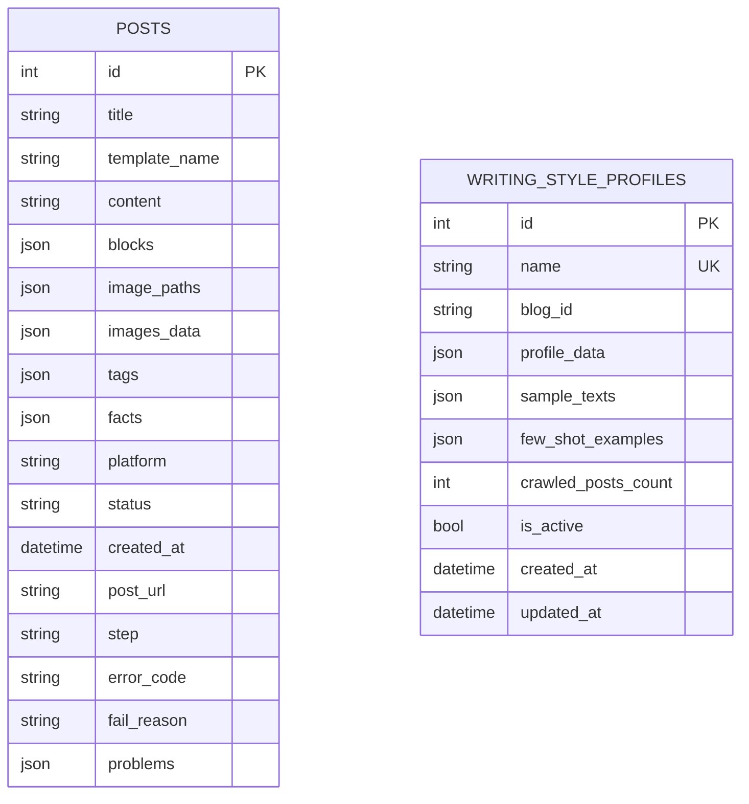

# Post Flow DB 스키마

> **최종 수정:** 2026-11-19 (처음 작성 2026-02-02)
> **관련 파일:** `backend/app/db/models.py`, `backend/app/db/migrate.py`, `backend/app/schemas/post.py`

SQLite 파일 하나(`backend/postflow.db`)에 표 두 개가 있습니다. 서버를 켤 때 `create_all`이 없는 표를 만들고, `migrate.py`의 `add_missing_columns`가 이미 있는 표에 새로 생긴 칸만 추가합니다(`create_all`은 기존 표에 칸을 추가하지 않아서). 기존 줄의 새 칸은 비어 있는(NULL) 채로 남습니다.

## ERD

두 표는 서로 참조하지 않습니다.

## `posts` (발행 기록)

[발행]을 누를 때마다 플랫폼별로 한 줄이 생깁니다. 발행에 쓴 글 전체와 발행 결과가 함께 저장됩니다.

| 칸 | 타입 | 설명 |
|---|---|---|
| `id` | Integer, PK | 발행 번호. 앱의 발행 결과 창이 이 번호로 상태를 묻는다 |
| `title` | String, Index | 글 제목 |
| `template_name` | String, NULL 가능 | 예전 템플릿 방식의 이름 (지금 글쓰기는 쓰지 않음) |
| `content` | String, NULL 가능 | 예전 글 본문 (지금은 `blocks`를 씀) |
| `blocks` | JSON | 글 블록 목록: text / image(`image_indices`) / quote(`style`) / map / divider |
| `image_paths` | JSON | 서버에 저장된 사진 파일 경로 목록 |
| `images_data` | JSON | 사진별 정보 (분류 등) |
| `tags` | JSON | 태그 목록 |
| `facts` | JSON | 가게 정보와 체크칸 (주소, 영업시간, 내돈내산·협찬 등) |
| `platform` | String | `NAVER` / `TISTORY` |
| `status` | String | `PROCESSING` → `SUCCESS` 또는 `FAIL` |
| `created_at` | DateTime | 만든 시각 (UTC) |
| `post_url` | String, NULL 가능 | 발행된 글 주소 (티스토리만 채움, 네이버는 임시저장이라 없음) |
| `step` | String, NULL 가능 | 진행 중일 때 지금 단계 (예: `글 넣는 중 (3/31)`). 끝나면 비움 |
| `error_code` | String, NULL 가능 | 실패 종류: `LOGIN_REQUIRED`(로그인 저장 필요) / `PUBLISH_ERROR` |
| `fail_reason` | String, NULL 가능 | 실패 이유 (사람이 읽는 문장) |
| `problems` | JSON, NULL 가능 | 저장 전 자가 검사의 "고칠 것" 목록 (있어도 임시저장은 됨) |

`step`, `error_code`, `fail_reason`, `problems`는 2026-11-19 발행 결과 창을 만들면서 추가했습니다.

### 상태 흐름

1. `POST /api/v1/posts/publish`: `PROCESSING`으로 한 줄을 만들고 백그라운드 발행 작업을 시작한다.
2. 발행 작업이 단계가 바뀔 때마다 `step`을 고친다.
3. 끝나면 `status`를 `SUCCESS`/`FAIL`로, 실패면 `error_code`·`fail_reason`을, 자가 검사 결과는 `problems`를 적는다. 예상하지 못한 오류도 `FAIL`로 적어 `PROCESSING`으로 남지 않게 한다.
4. `GET /api/v1/posts/{id}/status`: 앱이 3초마다 묻는다. `GET /api/v1/posts/history`: 전체 기록(최신순).

발행 중에 서버를 끄면 그 줄은 `PROCESSING`으로 남는다.

## `writing_style_profiles` (글쓰기 스타일 프로필)

기준 블로그 글에서 만든 스타일 프로필입니다. 활성 프로필(`is_active`)의 `few_shot_examples`가 글쓰기 프롬프트에 **말투 참고 예시**로 들어갑니다(문장을 그대로 쓰지 말라는 지시와 함께).

| 칸 | 타입 | 설명 |
|---|---|---|
| `id` | Integer, PK | |
| `name` | String, Unique | 프로필 이름 |
| `blog_id` | String, NULL 가능 | 글을 모은 블로그 ID |
| `profile_data` | JSON | 말투·어휘·구조 분석 결과 |
| `sample_texts` | JSON | 모은 글 원문 |
| `few_shot_examples` | JSON | 글쓰기에 넣는 예시 글 |
| `crawled_posts_count` | Integer | 모은 글 수 |
| `is_active` | Boolean | 지금 쓰는 프로필 (하나만) |
| `created_at`, `updated_at` | DateTime | |

프로필을 새로 만드는 학습 기능(Gemini 사용)은 2026-11-19에 지웠습니다. 지금은 저장된 프로필을 읽고, `/api/v1/style/profiles`로 목록·활성화·삭제만 합니다.
